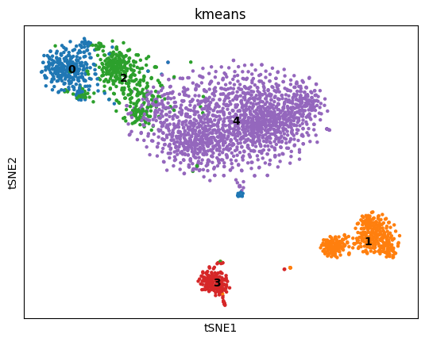
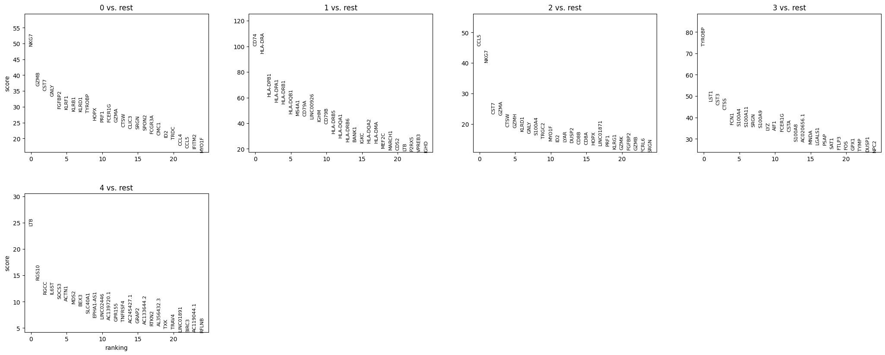
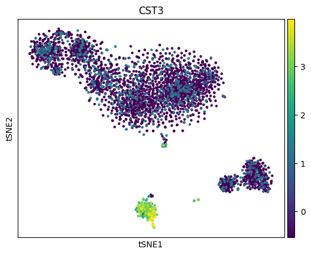
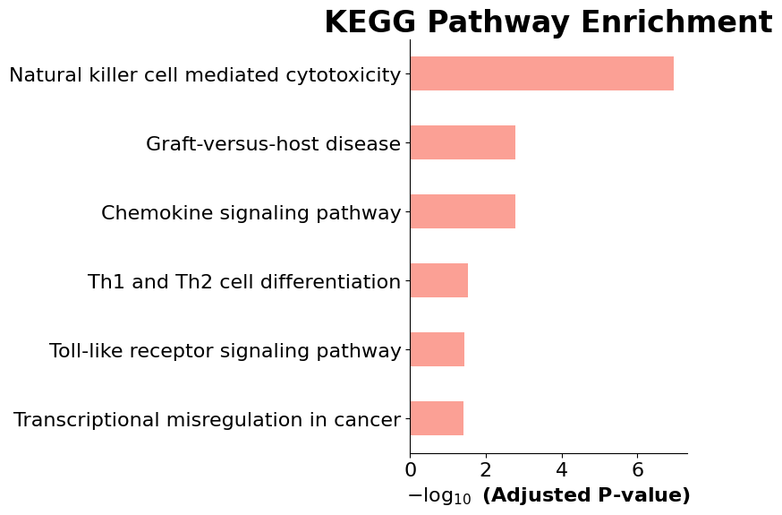

# Single-Cell RNA-seq Analysis of Human Blood Immune Cells

## The problem

A blood sample contains many immune cell types mixed together. Bulk RNA-seq averages them into one profile and hides the differences. Single-cell RNA-seq measures each cell separately, but the raw data is large, noisy and unlabelled. This notebook takes a raw 10x Genomics count matrix and answers two questions: which cell populations are in the sample, and what biology defines them.

## Data

`GSM3169075_filtered_gene_bc_matrices_h5.h5`, a 10x Genomics filtered gene-barcode matrix from GEO (sample GSM3169075).

- 3,372 cells and 58,302 genes before filtering
- The data file is not included in this repo; download it from GEO (see How to use)

## What the code does

`Single_Cell_Analysis.ipynb` runs a standard Scanpy workflow:

1. **Load** the 10x `.h5` matrix and make gene names unique.
2. **Quality control.** Remove cells with fewer than 200 genes, genes found in fewer than 3 cells, cells with 2,500 or more genes (likely doublets) and cells with 5% or more mitochondrial reads (likely damaged).
3. **Normalize** each cell to 10,000 counts and log-transform.
4. **Select highly variable genes** and scale them.
5. **Reduce dimensions** with PCA, then t-SNE on 50 PCs for visualization.
6. **Cluster** cells with K-means (k = 5) on the PCA space, check quality with the silhouette score, and build a dendrogram of cluster similarity.
7. **Find marker genes** for each cluster against all other cells (t-test).
8. **Pathway enrichment** of the top 100 markers of cluster 0 against KEGG 2019 using Enrichr (`gseapy`).

## Results

### Five immune cell populations



K-means split the cells into five clusters (silhouette score 0.23). Clusters 1 and 3 are clearly separate; clusters 0, 2 and 4 sit closer together, as expected for related lymphocytes. Each cluster was identified from its top marker genes:

| Cluster | Top markers | Cell type |
|---|---|---|
| 0 | NKG7, GZMB, GNLY, KLRF1, PRF1, FCGR3A | Natural killer (NK) cells |
| 1 | CD74, HLA-DRA, MS4A1, CD79A, CD79B, IGHM | B cells |
| 2 | CCL5, NKG7, GZMA, GZMH, GZMK, CD8A, CD8B | Cytotoxic CD8+ T cells |
| 3 | TYROBP, LST1, CST3, FCN1, S100A8, S100A9, LYZ | Monocytes |
| 4 | LTB, RGS10, IL6ST, TNFRSF4 | Naive / memory T cells |



The monocyte marker CST3 lights up only in cluster 3, confirming that call:



### NK cells are defined by killing pathways



The top markers of cluster 0 are strongly enriched for **natural killer cell mediated cytotoxicity** (10 genes, adjusted p = 1.1e-7), followed by chemokine signaling, graft-versus-host disease and Th1/Th2 differentiation. This independently confirms cluster 0 as NK cells, driven by perforin and granzyme genes (PRF1, GZMB).

### Limitations

- K-means with a fixed k = 5 is a simple choice. Graph-based clustering (Leiden) would likely split cluster 4 into finer T cell subsets.
- The silhouette score of 0.23 reflects real overlap between related lymphocyte groups, not a failed clustering.
- Enrichment was run for cluster 0 only.

## Other figures

| File | Content |
|---|---|
| `figures/pca_cst3.png` | First two principal components, coloured by CST3 |
| `figures/dendrogram.png` | Hierarchical similarity between the five clusters |

## How to use

The notebook was written for Google Colab but runs anywhere with Python 3.10 or newer.

1. Clone the repo:

```bash
git clone https://github.com/waqas288/Bioinformatics-Portfolio.git
cd Bioinformatics-Portfolio/Python
```

2. Install the packages:

```bash
pip install scanpy anndata pandas scikit-learn matplotlib seaborn gseapy jupyter
```

3. Download `GSM3169075_filtered_gene_bc_matrices_h5.h5` from GEO: https://www.ncbi.nlm.nih.gov/geo/query/acc.cgi?acc=GSM3169075

4. Open the notebook and set the data path. Running locally, skip the first two cells (Colab install and Google Drive mount) and set:

```python
data_path = "GSM3169075_filtered_gene_bc_matrices_h5.h5"
```

5. Run all cells.

To analyse your own sample, point `data_path` at any 10x `filtered_feature_bc_matrix.h5` file. Adjust the QC cut-offs (`min_genes`, `n_genes < 2500`, `pct_counts_mt < 5`) and the number of clusters to suit your data.
